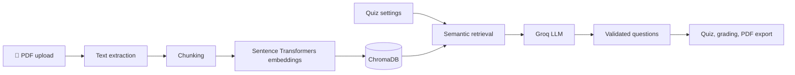
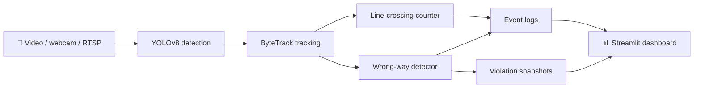
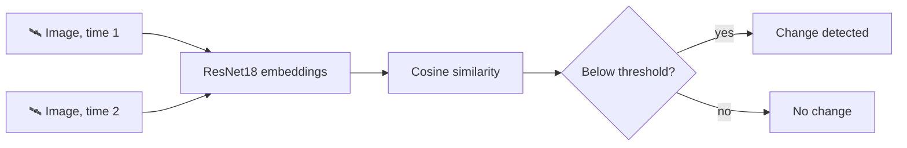
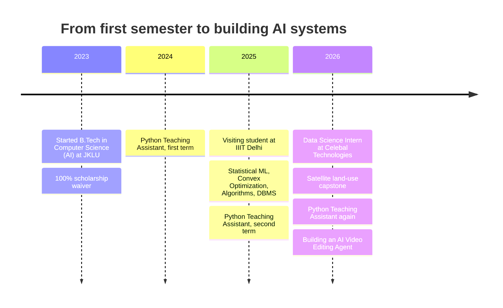

<div align="center">


<br>

<a href="https://github.com/kalpanabaghel296"></a>
<a href="https://www.linkedin.com/in/kalpana123baghel/"></a>
<a href="mailto:kalpanabaghel296@gmail.com"></a>

<p>
<a href="#-30-second-tour">30-sec tour</a> ·
<a href="#-about">About</a> ·
<a href="#-featured-projects">Projects</a> ·
<a href="#-under-the-hood">Under the hood</a> ·
<a href="#-research-and-responsible-ai">Research</a> ·
<a href="#-skills">Skills</a> ·
<a href="#-journey">Journey</a>
</p>

</div>

---

## 👾 whoami

```python
class Kalpana:
    name         = "Kalpana Baghel"
    studying     = "B.Tech CSE (AI) @ JK Lakshmipat University, Jaipur (2023-2027)"
    interned     = "Data Science @ Celebal Technologies"
    builds       = ["RAG apps", "computer vision systems", "full-stack AI tools"]
    cares_about  = ["responsible AI", "honest limitations", "things that actually run"]
    building_now = "AI Video Editing Agent (team project)"

    def say_hi(self):
        return "Let's build something useful."
```

---

## ⚡ 30-second tour

| If you want to see... | Start here |
|:--|:--|
| 🧠 A full-stack GenAI app, live | [EduQuiz](https://eduquiz.app): PDF to quiz with RAG |
| 👁️ Computer vision beyond a notebook | [Vehicle Detection and Traffic Analytics](https://github.com/kalpanabaghel296/Real-Time-Vehicle-Detection-Traffic-Analytics-System) |
| 🛰️ Transfer learning and honest evaluation | [Satellite Land-Use and Change Detection](https://github.com/kalpanabaghel296/Satellite-Image-Land-Use-Classifier-Temporal-Change-Detector) |
| ⚖️ Responsible AI research | [Gender-bias paper](#-research-and-responsible-ai) (co-authored) |

---

## 🌌 About

I'm a B.Tech student in **Computer Science and Artificial Intelligence** at **JK Lakshmipat University, Jaipur**, with a Data Science internship at Celebal Technologies behind me. I like building complete, useful applications rather than isolated models: understanding the problem, designing the architecture, implementing it, testing it, and iterating.

I'm still learning, and my repositories show that process, including the limitations I found along the way.

**🔭 Currently:** building the AI Video Editing Agent with my team · 🧑‍🏫 Python Lab TA at JKLU · ✍️ adding results and polish to my project READMEs

**💬 Ask me about:** RAG pipelines · tracking vehicles with ByteTrack · why my data-leakage experiment surprised me · fairness in healthcare ML

---

## 🚀 Featured Projects

<table>
<tr>
<td width="50%" valign="top">

<h4>🧠 <a href="https://github.com/kalpanabaghel296/Quiz_Generator">EduQuiz</a>: PDF to quiz with RAG</h4>
<p>Upload a text-based PDF and generate MCQ, short-answer or mixed quizzes grounded in the document. Text is chunked, embedded locally, retrieved from ChromaDB and passed to a Groq LLM. Includes automatic grading, result breakdown and PDF export.</p>
<p><sub><b>Stack:</b> Python, FastAPI, React, Vite, Groq, ChromaDB, Sentence Transformers, LangChain text splitters</sub></p>
<p><sub><b>Limitation:</b> supports text-based PDFs only; OCR for scanned PDFs is not included.</sub></p>
<p><sub><a href="https://github.com/kalpanabaghel296/Quiz_Generator">Repository</a> · <a href="https://eduquiz.app">Live demo</a></sub></p>

</td>
<td width="50%" valign="top">

<h4>🚦 <a href="https://github.com/kalpanabaghel296/Real-Time-Vehicle-Detection-Traffic-Analytics-System">Vehicle Detection and Traffic Analytics</a></h4>
<p>Detects and tracks vehicles in traffic video, counts them as they cross a virtual line, and flags wrong-way movement. A Streamlit dashboard shows live metrics and saved violation snapshots. The repository includes a pytest suite and an evaluation module.</p>
<p><sub><b>Stack:</b> Python, YOLOv8, ByteTrack, OpenCV, PyTorch, Streamlit</sub></p>
<p><sub><a href="https://github.com/kalpanabaghel296/Real-Time-Vehicle-Detection-Traffic-Analytics-System">Repository</a> · <a href="https://real-time-vehicle-detection-traffic-analytics-system.streamlit.app/">Live demo</a></sub></p>

</td>
</tr>
<tr>
<td width="50%" valign="top">

<h4>🎒 <a href="https://github.com/kalpanabaghel296/AI-Study-Assistent">BACKBENCH</a>: AI study assistant</h4>
<p>A full-stack learning platform with an AI tutor, PDF-based learning, quizzes, a study planner, flashcards and a sticky-note board. Added email-OTP signup, JWT sign-in and session restore around the original dashboard.</p>
<p><sub><b>Stack:</b> React, Vite, Tailwind CSS, FastAPI, MongoDB Atlas, Groq, PyMuPDF</sub></p>
<p><sub><b>Status:</b> learning data is not yet partitioned per user, so it is not ready for multi-user private data. The README lists this as a next step.</sub></p>
<p><sub><a href="https://github.com/kalpanabaghel296/AI-Study-Assistent">Repository</a></sub></p>

</td>
<td width="50%" valign="top">

<h4>🛰️ <a href="https://github.com/kalpanabaghel296/Satellite-Image-Land-Use-Classifier-Temporal-Change-Detector">Satellite Land-Use Classifier and Change Detector</a></h4>
<p>Capstone project of my Data Science internship at Celebal Technologies. On EuroSAT, a from-scratch CNN baseline reached 91.57% accuracy and ResNet18 transfer learning reached 96.35% on the test split. A change detector compares image embeddings with cosine similarity, with a Streamlit demo, Grad-CAM and t-SNE views.</p>
<p><sub><b>Stack:</b> Python, PyTorch, ResNet18, Streamlit</sub></p>
<p><sub><b>Limitations:</b> cross-dataset accuracy on UC Merced was only 34.89%, showing a real domain gap. The change detector was tested on same-class versus different-class proxy pairs, not a real change-detection dataset.</sub></p>
<p><sub><a href="https://github.com/kalpanabaghel296/Satellite-Image-Land-Use-Classifier-Temporal-Change-Detector">Repository</a> · <a href="https://satellite-image-land-use-classifier-temporal-change-detector.streamlit.app/">Live demo</a></sub></p>

</td>
</tr>
<tr>
<td width="50%" valign="top">

<h4>🎙️ <a href="https://github.com/kalpanabaghel296/Hey_Olivia">Hey Olivia</a>: voice assistant (team project)</h4>
<p>A Windows voice assistant that takes Hindi, English or Hinglish speech, converts it to text, classifies the intent with a scikit-learn model, runs the action, and replies with text-to-speech. Also integrates a Groq LLM.</p>
<p><sub><b>Stack:</b> Python, Flask, SpeechRecognition, NLTK, scikit-learn, Groq, pyttsx3, HTML/CSS/JavaScript</sub></p>
<p><sub><a href="https://github.com/kalpanabaghel296/Hey_Olivia">Repository</a></sub></p>

</td>
<td width="50%" valign="top">

<h4>🧭 <a href="https://github.com/kalpanabaghel296/MindSathi-AI">MindSathi-AI</a>: research prototype</h4>
<p>Leakage-aware preprocessing and data audits for behavioral and wearable datasets (including StudentLife and WESAD), plus a prototype dashboard and companion chat with a safety layer. Outputs are research risk indicators, <b>not diagnoses</b>.</p>
<p><sub><b>Stack:</b> Python, scikit-learn, Flask, pytest</sub></p>
<p><sub><b>Status:</b> the model-training script has only been smoke-tested on synthetic data and has not been run or validated on the real splits.</sub></p>
<p><sub><a href="https://github.com/kalpanabaghel296/MindSathi-AI">Repository</a></sub></p>

</td>
</tr>
</table>

### 🔨 Currently building

**[AI Video Editing Agent](https://github.com/kalpanabaghel296/Video-Editor-Agent)** is an ongoing team project: an agent that edits video from natural-language instructions, using FFmpeg for rendering and faster-whisper for captions. It is in active development, so the repository is an early work in progress.

---

## 🔬 Under the hood

<sub>Click a project to see how it works.</sub>

<details>
<summary><b>🧠 EduQuiz: how a PDF becomes a quiz</b></summary>



</details>

<details>
<summary><b>🚦 Traffic analytics: from video frame to violation alert</b></summary>



</details>

<details>
<summary><b>🛰️ Change detection: did this place change?</b></summary>



<sub>Evaluated on proxy pairs (same class vs. different class), as noted in the project card above.</sub>

</details>

---

## ⚖️ Research and Responsible AI

**Co-authored paper: "A Comparative Study of Gender Bias in Machine Learning Models for Healthcare Prediction."** Using the Indian Liver Patient Dataset, we compared Logistic Regression, Random Forest and a Neural Network, analysing prediction disparities between male and female patients. We looked at accuracy and recall gaps and at false-positive and false-negative rates, and used SHAP, LIME and permutation feature importance to examine what drives predictions.

> ⚠️ This was an academic comparison. It is not a clinical system and must not be used for medical diagnosis.

**How I try to build responsibly:**
- 🧪 Splitting data to avoid leakage, and checking my own assumptions (my satellite project documents a leakage experiment that did not behave as expected).
- 📝 Stating limitations in the READMEs, such as proxy evaluation, domain gaps and unvalidated model code.
- 🛑 Treating sensitive-domain outputs as research indicators, never as diagnoses.

---

## 🧰 Skills

<div align="center">


</div>

| Area | Tools |
|:--|:--|
| **Languages** | Python · C · C++ · Java · SQL · JavaScript · HTML/CSS |
| **ML and Data Science** | PyTorch · TensorFlow · Keras · scikit-learn · NumPy · Pandas · Matplotlib · NLTK |
| **Computer Vision** | OpenCV · CNNs · Transfer Learning · YOLOv8 · ByteTrack · Grad-CAM |
| **GenAI and RAG** | RAG · LangChain · ChromaDB · Sentence Transformers · Groq API · Prompt Engineering |
| **Backend and Frontend** | FastAPI · Flask · MongoDB Atlas · React · Vite · Tailwind CSS · Streamlit |
| **Tools** | Git · GitHub · Jupyter · Postman · Vercel · Render · pytest |

---

## 🗺️ Journey



<details>
<summary><b>Details</b></summary>

- **Data Science Intern**, Celebal Technologies, Jaipur (May–Jul 2026): data preprocessing, modeling, evaluation and optimization with Python, PyTorch and scikit-learn; built the satellite land-use project as the capstone
- **Python Teaching Assistant**, JK Lakshmipat University (Aug–Dec 2024, Aug–Dec 2025, Aug 2026–present): supported students in lab work and debugging, and designed and evaluated problems for a Python coding contest
- **Visiting Student, IIIT Delhi** (Jan–Apr 2025): Statistical Machine Learning, Convex Optimization, Design and Analysis of Algorithms, DBMS
- **B.Tech, Computer Science (AI)**, JK Lakshmipat University (2023–2027), with a 100% scholarship waiver
- **Semester 6 update** (shared on LinkedIn): 9.037 SGPA, with an 8.397 CGPA at that time

</details>

---

## 📈 GitHub Activity

<div align="center">


<br><br>

<a href="https://github.com/kalpanabaghel296?tab=repositories"></a>

<br><br>

<picture>
  <source media="(prefers-color-scheme: dark)" srcset="https://raw.githubusercontent.com/kalpanabaghel296/kalpanabaghel296/output/github-snake-dark.svg">
  
</picture>

</div>

---

## 📡 Connect

<div align="center">

<b>Open to learning, collaborating and building useful things.</b>

<a href="https://www.linkedin.com/in/kalpana123baghel/">LinkedIn</a> · <a href="https://github.com/kalpanabaghel296">GitHub</a> · <a href="mailto:kalpanabaghel296@gmail.com">kalpanabaghel296@gmail.com</a>

<sub>Learn. Build. Test. Be honest about the results. Repeat. ✨</sub>


</div>
